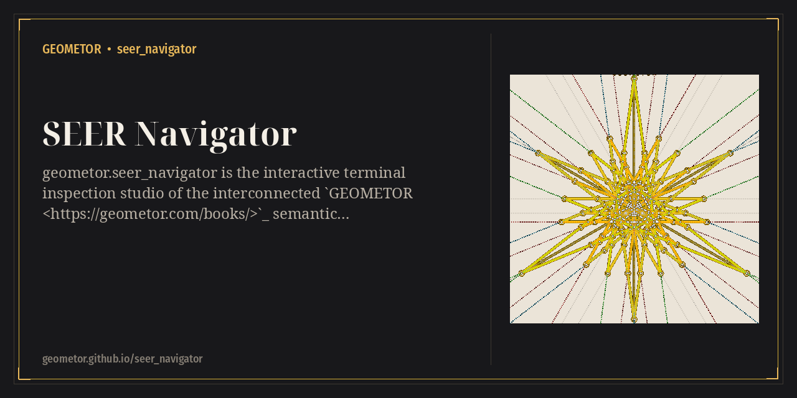

GEOMETOR • seer_navigator
=========================

**Visit the Online Archive:** https://geometor.github.io/seer_navigator/

**SEER Navigator • Textual TUI browser for inspecting SEER reasoning sessions and trials**

Mission
-------

``geometor/seer_navigator`` is part of the interconnected `GEOMETOR <https://geometor.com>`_ semantic digital archive. It provides a keyboard-driven terminal user interface (TUI) built with Textual for browsing, inspecting, and evaluating multi-agent abstract visual reasoning sessions. By transforming complex JSON trial logs, candidate grid diffs, and synthesized Python code into real-time interactive terminal views, it liberates empirical AI research from opaque text files into transparent visual workbenches across the GEOMETOR corpus.

Capabilities & Interactive Docs
-------------------------------

- `SEER Navigator TUI <https://geometor.github.io/seer_navigator/>`_ — Interactive Textual terminal dashboard for reviewing SEER benchmark results.
- `Sessions Navigator Screen <https://geometor.github.io/seer_navigator/usage/>`_ — Hierarchical session tree and summary metrics across reasoning runs.
- `Tasks & Trials Inspector <https://geometor.github.io/seer_navigator/usage/>`_ — Filter puzzles by pass/fail status, inspect input/output test grids, and trace synthesized Python code.
- `Visual Grid Renderers <https://geometor.github.io/seer_navigator/modules/>`_ — Color-accurate terminal block rendering and diff heatmaps for ARC puzzle states.

Usage
-----

.. code-block:: bash

   seer_navigator --session_dir <path/to/sessions>

Repository Contents
-------------------

- ``docsrc/`` — RST documentation, TUI guides, and module references compiled by `PHOTON publish <https://github.com/photon-platform/publish>`_.
- ``src/geometor/seer_navigator/`` — Textual application, screen layouts, terminal grid renderers, and CLI entry point.

Local Build & Verification
--------------------------

.. code-block:: bash

   publish build

Part of the GEOMETOR Knowledge Archive
--------------------------------------

Explore all **74 Book Codices** and **11 Mathematical Catalogs** at https://geometor.com/books/.
