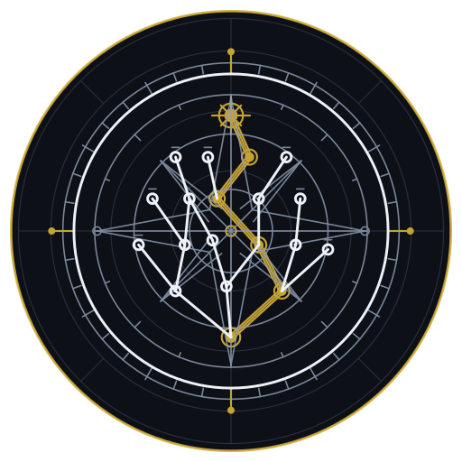

:site_title: SEER Navigator

.. container:: author-overline

   semantic digital archive • reasoning studio

==============
SEER Navigator
==============

``geometor.seer_navigator`` is the interactive terminal inspection studio of the interconnected `GEOMETOR <https://geometor.com/books/>`_ semantic digital archive. Built with Textual and Rich, it provides an operator's dashboard for navigating multi-agent visual reasoning sessions, evaluating ARC trial outcomes, and inspecting synthesized transformation code.

.. include:: intro.rst

recent logs
-----------

.. collection::
   :type: log
   :sort: date
   :reverse:
   :limit: 5

.. toctree::
   :hidden:
   :maxdepth: 2

   mission/index.rst
   usage/index.rst
   modules/index.rst
   logs.rst
   demos/index.rst
   refs/index.rst
   todos/index.rst
   changelog.rst
   connect.rst
   about.rst

indices
-------

* :ref:`genindex`
* :ref:`modindex`
* :ref:`search`